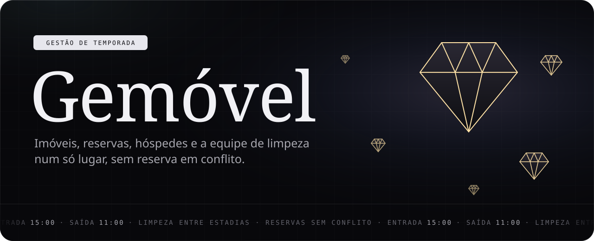
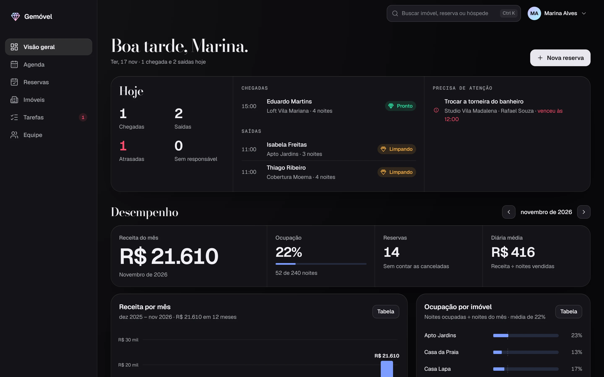
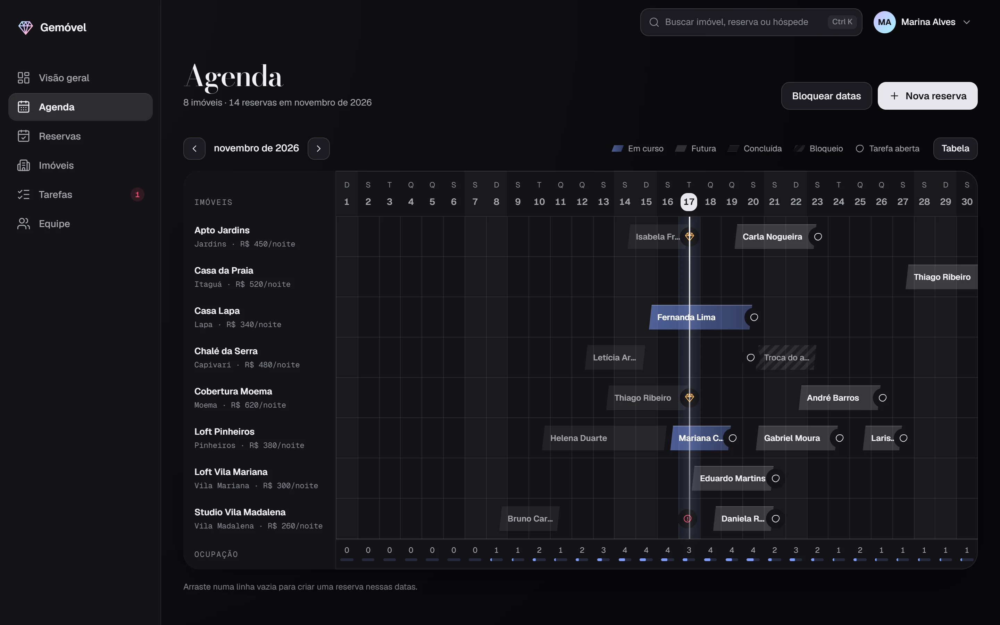
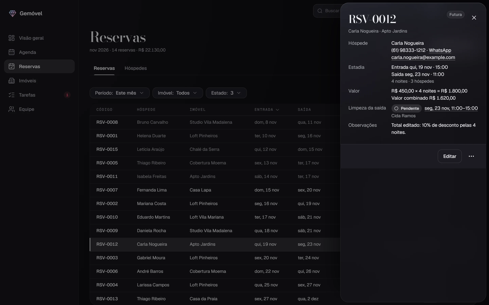
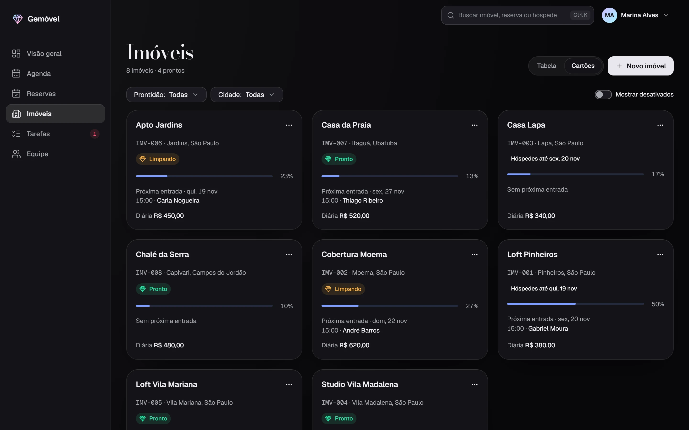
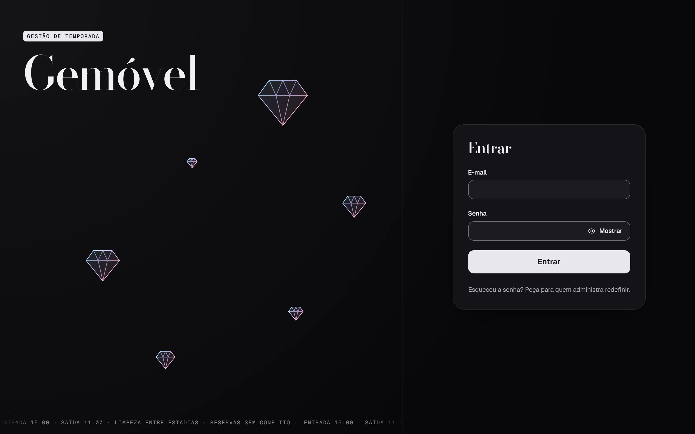
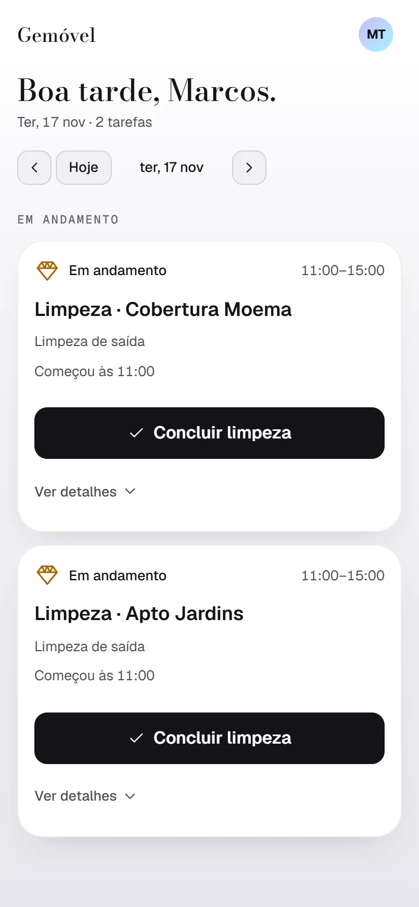
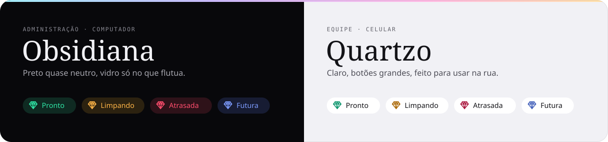
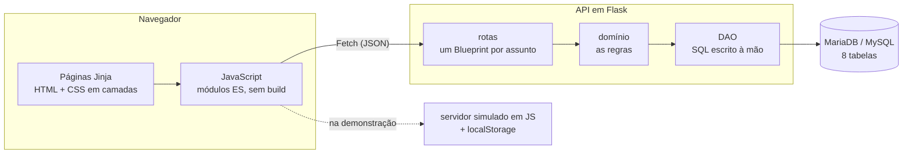

<div align="center">



<br>

[](https://washington-dev-fullstack.github.io/gemovel-integrative-project/)


**[Abrir a demonstração](https://washington-dev-fullstack.github.io/gemovel-integrative-project/)** &nbsp;·&nbsp; [Como rodar](LEIA-ME.md) &nbsp;·&nbsp; [Sistema de design](DESIGN.md) &nbsp;·&nbsp; [Diagramas](banco/diagramas/)

</div>

<br>

O **Gemóvel** cuida de imóveis de aluguel por temporada: os imóveis, as reservas, os hóspedes e as tarefas de limpeza e manutenção da equipe. A agenda não deixa duas reservas no mesmo imóvel, cada saída já cria a limpeza para a equipe, e quem limpa acompanha tudo pelo celular.

Projeto integrado do **Técnico em Informática, turma 2 TID**.


## O sistema



<p align="center"><sub><b>Visão geral.</b> As chegadas e saídas do dia, o que está atrasado e o desempenho do mês.</sub></p>

<table>
  <tr>
    <td width="50%" valign="top">
      
      <p align="center"><sub><b>Agenda.</b> O mês inteiro de cada imóvel, com a ocupação por dia. Arraste numa linha vazia para reservar.</sub></p>
    </td>
    <td width="50%" valign="top">
      
      <p align="center"><sub><b>Reservas.</b> A gaveta mostra o hóspede, a estadia, o valor e a limpeza da saída.</sub></p>
    </td>
  </tr>
  <tr>
    <td width="50%" valign="top">
      
      <p align="center"><sub><b>Imóveis.</b> Quem está pronto, quem está em limpeza e a próxima entrada.</sub></p>
    </td>
    <td width="50%" valign="top">
      
      <p align="center"><sub><b>Entrar.</b> O momento da marca: o admin cai na Visão geral, e a equipe, nas próprias tarefas.</sub></p>
    </td>
  </tr>
</table>

<table>
  <tr>
    <td width="34%" valign="middle" align="center">
      
    </td>
    <td width="66%" valign="middle">
      <h3>Minhas tarefas, no celular</h3>
      <p>A equipe usa um app à parte, claro e com botões grandes, feito para ser usado no meio do serviço. Cada pessoa vê as tarefas do dia e as que ficaram atrasadas, começa e conclui com um toque, e ainda pode desfazer por 10 segundos se tocar sem querer.</p>
      <p>Cada mudança fica registrada no histórico da tarefa, e o administrador vê na hora quando um imóvel fica pronto.</p>
    </td>
  </tr>
</table>


## O que ele faz

<table>
  <tr>
    <td width="50%" valign="top">
      <h4>Para quem administra</h4>
      <ul>
        <li><b>Agenda do mês</b> com reservas, bloqueios e tarefas abertas em cada imóvel</li>
        <li><b>Reservas sem conflito:</b> o sistema recusa datas que se sobrepõem</li>
        <li><b>Limpeza automática:</b> toda reserva já cria a limpeza da saída</li>
        <li><b>Hóspedes</b> com busca por nome ou telefone e cadastro na hora</li>
        <li><b>Imóveis</b> com prontidão, ocupação e datas bloqueadas</li>
        <li><b>Equipe:</b> cadastro, função, senha e desativação</li>
        <li><b>Busca geral</b> no topo (<kbd>Ctrl</kbd> <kbd>K</kbd>) e números do mês</li>
      </ul>
    </td>
    <td width="50%" valign="top">
      <h4>Para a equipe</h4>
      <ul>
        <li><b>Tarefas do dia</b> e as atrasadas, em ordem de prazo</li>
        <li><b>Começar e concluir</b> com um toque</li>
        <li><b>Desfazer</b> até 10 segundos depois</li>
        <li><b>Histórico</b> de cada mudança de estado</li>
      </ul>
      <h4>Por baixo</h4>
      <ul>
        <li>Cada administrador vê <b>só os próprios dados</b></li>
        <li>Imóveis e pessoas são desativados, <b>nunca apagados</b></li>
        <li>Senhas guardadas só como <b>hash</b></li>
        <li>Toda tela tem estados de <b>carregando, vazio e erro</b></li>
      </ul>
    </td>
  </tr>
</table>


## Identidade visual



A interface segue o sistema **Lapidado**: o administrador usa o tema escuro **Obsidiana**, no computador, e a equipe usa o claro **Quartzo**, no celular. O status de cada coisa aparece como uma gema, sempre com forma e rótulo, para nunca depender só da cor. O prisma (ciano, lilás, rosa e champanhe) fica só na identidade, como na logo. Os títulos usam a **Bodoni Moda**, e o resto, a **Geist**, as duas servidas pelo próprio sistema, que funciona sem internet.

Tudo isso está em [DESIGN.md](DESIGN.md), com as cores, os tipos, os componentes e as regras de acessibilidade.


## Como é feito



| Camada | O que usa |
|---|---|
| **Banco** | MariaDB 10.4 do XAMPP (o SQL também roda no MySQL), 8 tabelas, `sql_mode` estrito |
| **API** | Python 3.13, Flask 3.1, `mysql-connector-python`, sessão por cookie assinado |
| **Telas** | HTML (Jinja), CSS em `@layer` com tokens, JavaScript em módulos ES, View Transitions |
| **Testes** | `unittest` no banco de verdade e `node --test` nas regras das telas |
| **Demonstração** | GitHub Pages, com as rotas da API refeitas em JavaScript |


## Rodar no computador

Precisa do **XAMPP** (com o MySQL ligado) e do **Python 3.13**. Da pasta do projeto:

```bash
C:/xampp/mysql/bin/mysql.exe -u root --default-character-set=utf8mb4 -e "source banco/01_estrutura.sql"
```

```bash
C:/xampp/mysql/bin/mysql.exe -u root --default-character-set=utf8mb4 -e "source banco/02_dados_exemplo.sql"
```

```bash
python -m venv backend/.venv
```

```bash
backend/.venv/Scripts/python -m pip install -r backend/requirements.txt
```

```bash
backend/.venv/Scripts/python backend/app.py
```

Depois abra http://localhost:5000/entrar. O passo a passo completo, com o `.env`, as contas de teste e o que fazer se der problema, está no **[LEIA-ME.md](LEIA-ME.md)**.

> [!TIP]
> Para só ver o sistema, sem instalar nada: dê dois cliques em `Abrir o site.bat` ou abra a [demonstração online](https://washington-dev-fullstack.github.io/gemovel-integrative-project/). Na tela de entrar, escolha uma das contas de exemplo.


## Onde está cada coisa

| Pasta | O que tem |
|---|---|
| `frontend/` | as telas do sistema: páginas, CSS e JavaScript |
| `backend/` | a API em Flask (Python) e os testes dela |
| `banco/` | o SQL do banco, os dados de exemplo, os diagramas e o PDF das modelagens |
| `design/` | as telas e os componentes aprovados |
| `docs/` | os documentos da escola, as especificações e os planos |
| `ferramentas/` | o gerador da pasta `site/` e o programa que o `Abrir o site.bat` roda |
| `site/` | a demonstração que vai para o GitHub Pages (é gerada: não edite à mão) |

## Entregas

| Data | Etapa | |
|---|---|:---:|
| 09/11/2026 | Diagramas UML, tabelas criadas e conexão do Python com o banco | ✅ |
| 13/11/2026 | Classes, DAOs e rotas Flask, com cadastrar e listar funcionando | ✅ |
| 17/11/2026 | Front-end em HTML, CSS e JavaScript chamando as rotas via Fetch | ✅ |


## Quem fez

<table>
  <tr>
    <td align="center" width="50%">
      <a href="https://github.com/Washington-dev-fullstack">
        <br>
        <b>Washington</b>
      </a><br>
      <sub><a href="https://github.com/Washington-dev-fullstack">@Washington-dev-fullstack</a></sub>
    </td>
    <td align="center" width="50%">
      <a href="https://github.com/Artgaming241">
        <br>
        <b>Arthur Gazzoli</b>
      </a><br>
      <sub><a href="https://github.com/Artgaming241">@Artgaming241</a></sub>
    </td>
  </tr>
</table>

<br>

<div align="center">
  <br>
  <sub>Gemóvel · Projeto integrado do Técnico em Informática · turma 2 TID · 2026</sub>
</div>
